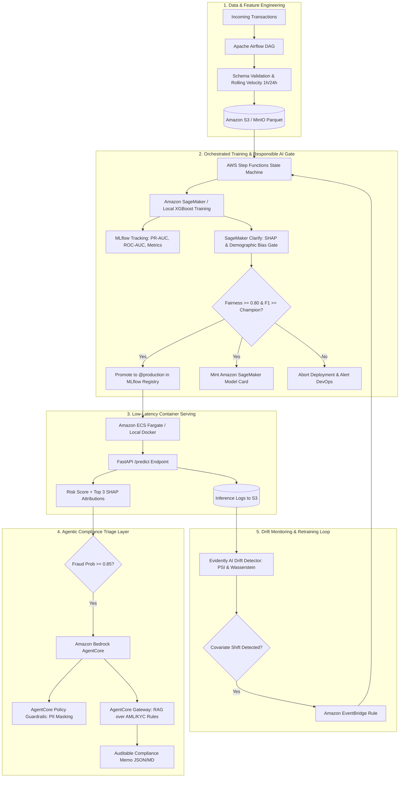

# Closed-Loop Financial Risk MLOps Platform with Automated Drift Retraining & Agentic Audit Triage on AWS

[](https://www.python.org/downloads/)
[](https://fastapi.tiangolo.com)
[](https://mlflow.org)
[](https://aws.amazon.com/step-functions/)
[](https://www.terraform.io)
[](https://github.com/aquasecurity/trivy)
[](LICENSE)

A production-grade, end-to-end MLOps and LLMOps platform engineered for financial risk and credit card fraud detection. It scores live transactions in single-digit milliseconds, explains high-risk flags using a governed AI agent grounded in AML/KYC regulatory policy, continuously monitors feature distribution drift, and automatically retrains, audits, and redeploys models via AWS Step Functions—all provisioned with declarative Terraform and protected with shift-left DevSecOps gates.

Tailored for enterprise consulting standards (**UST MLOps Engineer / ML Engineer I — Job ID: 634702**).

---

## 1. Real-World Business Problem Solved

Deploying financial risk models to live production frequently suffers from four critical failures:
1. **Silent Model Degradation (Data Drift):** Fraud syndicates alter patterns (surges in cross-border velocity, structured transaction amounts). A model trained last month suffers precision collapse today without automated drift monitoring.
2. **Black-Box Regulatory Failures (AML/KYC):** Regulators (FinCEN, CFPB) reject raw probability scores (e.g., `0.94`). They mandate explainable feature drivers and citations of applicable compliance policies.
3. **Manual, Error-Prone Deployments:** Notebook-to-production handoffs without automated Champion/Challenger registries lead to downtime and unversioned weights.
4. **Security & Governance Exposure:** Unscanned container images, over-privileged IAM permissions, and biased models expose banks to severe regulatory fines and security vulnerabilities.

### The Platform Solution
- **Automated State Machine Orchestration:** Replaces fragile cron jobs with a visual, fault-tolerant **AWS Step Functions** workflow.
- **Champion/Challenger Registry:** Managed via **MLflow Model Registry** with strict `@staging` and `@production` aliases backed by S3.
- **Responsible AI Bias Gates:** Mirrors **Amazon SageMaker Clarify** to compute Disparate Impact and Demographic Parity Difference across protected demographic groups before deployment.
- **Agentic RAG Compliance Triage:** Uses **Amazon Bedrock AgentCore**, **AgentCore Gateway**, and **AgentCore Policy** guardrails to turn numerical SHAP values into auditable compliance decision memos.
- **Closed-Loop Self-Healing:** **Evidently AI** evaluates Population Stability Index (PSI) and Wasserstein distance, firing an **Amazon EventBridge** trigger to re-train the pipeline upon drift detection.
- **Zero-Trust DevSecOps:** **Aqua Security Trivy** scans Python dependencies, Docker containers, and Terraform IaC configurations in **GitHub Actions**.
- **Cost-Conscious Cloud Engineering:** Dual-mode architecture (`ENV=local` vs `ENV=aws`) allows 100% free local development on Docker Compose, with cloud infrastructure that can be torn down in one command (`make tf-destroy`).

---

## 2. End-to-End System Architecture



---

## 3. Technology Stack Reference & UST Job ID 634702 Alignment

| Requirement Area | Tools & Technologies | Platform Implementation |
| :--- | :--- | :--- |
| **Data Engineering** | Apache Airflow, Pandas, PyArrow | Daily ingestion DAG, rolling velocity calculation, schema validation, versioned Parquet splits in S3. |
| **Model Development** | XGBoost, Scikit-Learn, SHAP | Class-imbalance-aware gradient boosting (`scale_pos_weight`), local & global TreeSHAP explainability. |
| **Model Registry & Tracking** | MLflow Tracking, MLflow Model Registry | Hyperparameter/metric logging, artifact lineage, Champion vs. Challenger promotion to `@production`. |
| **Workflow Automation** | AWS Step Functions, Amazon SageMaker | Visual Amazon States Language (ASL) state machine with `Retry`, `Catch`, and automated rollback gates. |
| **Responsible AI & Governance**| Amazon SageMaker Clarify, Model Cards | Disparate Impact Ratio ($\ge 0.80$), Demographic Parity Difference ($|\Delta| \le 0.10$), JSON/MD Model Cards. |
| **Real-Time Serving** | FastAPI, Uvicorn, Pydantic v2, Docker | Sub-15ms async API with Pydantic validation, Prometheus metrics exporter, and S3 inference streaming. |
| **Agentic AI & LLMOps** | Amazon Bedrock AgentCore, Gateway, Policy | RAG retrieval over AML/KYC policy documents, PII masking guardrails, structured SAR audit memos. |
| **Drift Monitoring** | Evidently AI, Amazon EventBridge | Population Stability Index (PSI) and Wasserstein distance monitoring triggering automated retraining. |
| **Infrastructure as Code** | Terraform (AWS Provider 5.x) | Modular definitions for VPC, ECS Fargate, ALB, S3, Step Functions, EventBridge, and IAM roles. |
| **DevSecOps & CI/CD** | GitHub Actions, Aqua Security Trivy | Shift-left vulnerability scans on OS packages, Python dependencies, Docker images, and Terraform configs. |

---

## 4. Repository Structure

```
mlops/
├── .github/
│   └── workflows/
│       └── ci_cd_devsecops.yml        # GitHub Actions: Ruff, Pytest, Trivy scans, Docker build & push
├── airflow/
│   └── dags/
│       └── fraud_feature_pipeline_dag.py # Airflow ingestion, validation, and feature DAG
├── data/                               # Versioned Parquet datasets and schema metadata
│   ├── raw_transactions.parquet
│   ├── train.parquet
│   ├── validation.parquet
│   ├── test.parquet
│   └── reference_data.parquet
├── scripts/
│   ├── setup_env.ps1                  # Environment & CLI toolpath verification
│   ├── create_bin_links.ps1           # Windows binary link wrappers
│   └── manage.ps1                     # Native PowerShell management CLI (mirrors Makefile)
├── src/
│   ├── data/
│   │   ├── generate_synthetic_transactions.py # Synthetic data & controlled drift generator
│   │   └── preprocess.py              # Chronological splits, scaling & velocity features
│   ├── training/
│   │   └── train_xgboost.py           # XGBoost training + MLflow tracking + SHAP serialization
│   ├── governance/
│   │   ├── evaluate_fairness_and_explainability.py # SageMaker Clarify bias & model card gate
│   │   └── promote_model.py           # Champion vs. Challenger registry promoter
│   ├── inference/
│   │   ├── app.py                     # FastAPI server with Prometheus metrics & SHAP attribution
│   │   ├── schemas.py                 # Pydantic v2 validation contracts
│   │   └── Dockerfile                 # Hardened, non-root multi-stage Docker container
│   ├── agentcore/
│   │   ├── compliance_triage_agent.py # Bedrock AgentCore RAG compliance triage agent
│   │   ├── agentcore_policy.json      # Declarative AgentCore Policy & PII masking guardrails
│   │   └── knowledge_base/
│   │       └── aml_kyc_policies.md    # Regulatory guidelines (FinCEN, BSA, AML) for RAG
│   └── monitoring/
│       ├── drift_detector.py          # Evidently AI drift detector & EventBridge dispatcher
│       ├── prometheus.yml             # Prometheus scrape configuration
│       └── grafana_dashboard.json     # Pre-built monitoring dashboard
├── statemachine/
│   └── mlops_retraining_pipeline.asl.json # AWS Step Functions visual state machine definition
├── terraform/
│   ├── main.tf                        # S3, ECR, CloudWatch log groups
│   ├── variables.tf                   # Environment, region, and project variables
│   ├── iam.tf                         # Least-privilege IAM roles and execution policies
│   ├── ecs.tf                         # ECS Fargate cluster, task definition, ALB, and auto-scaling
│   ├── step_functions.tf              # AWS Step Functions state machine resources
│   ├── eventbridge.tf                 # EventBridge drift rule and Step Functions target
│   └── outputs.tf                     # ALB DNS, ECR URL, S3 bucket names, Step Functions ARN
├── tests/
│   ├── test_preprocessing.py          # Unit tests for feature pipeline & splits
│   ├── test_governance_gate.py        # Fairness thresholds & model card generation tests
│   └── test_inference.py              # FastAPI endpoint & SHAP calculation tests
├── docker-compose.yml                 # Local stack: MLflow, MinIO, Postgres, Prometheus, Grafana
├── Makefile                           # Unified orchestration commands
├── pyproject.toml                     # Python packaging & Ruff/Pytest config
├── requirements.txt                   # Pinned production dependencies
└── README.md
```

---

## 5. Quickstart Guide (Local Execution Mode)

### Step 1: Environment Setup
Initialize the isolated virtual environment and verify installed tools:
```bash
# On Unix / macOS
make setup

# On Windows (PowerShell)
.\scripts\manage.ps1 help
```

### Step 2: Spin Up Local MLOps Stack
Start MinIO (S3), PostgreSQL, MLflow, Prometheus, and Grafana:
```bash
make local-up
# Or on Windows:
.\scripts\manage.ps1 local-up
```
- **MLflow Tracking UI:** [http://localhost:5000](http://localhost:5000)
- **MinIO S3 Console:** [http://localhost:9001](http://localhost:9001) (`minioadmin` / `minioadminpassword`)
- **Grafana Dashboard:** [http://localhost:3000](http://localhost:3000) (`admin` / `admin`)
- **Prometheus UI:** [http://localhost:9090](http://localhost:9090)

### Step 3: Generate Data & Feature Splits
```bash
make data
# Or on Windows:
.\scripts\manage.ps1 data
```

### Step 4: Train Model & Log to MLflow
```bash
make train
# Or on Windows:
.\scripts\manage.ps1 train
```

### Step 5: Run Governance & Fairness Gate
```bash
make govern
# Or on Windows:
.\scripts\manage.ps1 govern
```

### Step 6: Promote Candidate to Production
```bash
make promote
# Or on Windows:
.\scripts\manage.ps1 promote
```

### Step 7: Launch Real-Time Inference Microservice
```bash
make serve
# Or on Windows:
.\scripts\manage.ps1 serve
```
Interactive Swagger docs: [http://localhost:8000/docs](http://localhost:8000/docs)

### Step 8: Simulate Drift & Trigger Retraining
```bash
make simulate-drift
# Or on Windows:
.\scripts\manage.ps1 simulate-drift
```

### Step 9: Run Security Scans
```bash
make security-scan
# Or on Windows:
.\scripts\manage.ps1 security-scan
```

---

## 6. Cloud Deployment & Teardown (Terraform on AWS)

To execute a live demo in AWS while ensuring zero unexpected costs:

### 1. Configure AWS Credentials
```bash
aws configure
```

### 2. Provision Infrastructure
```bash
make tf-init
make tf-plan
make tf-apply
```

### 3. Immediate Cloud Teardown
To ensure your AWS bill remains under $10, run the teardown command immediately after your demonstration:
```bash
make tf-destroy
```

---

## 7. Model Governance & Responsible AI Auditing

Every model evaluated by this platform is verified against strict fairness gates before reaching `@production`:
- **Disparate Impact Ratio ($DI$):** Must satisfy $DI \ge 0.80$ across all age groups (`customer_age_group`).
- **Statistical Parity Difference ($|SPD|$):** Must satisfy $|SPD| \le 0.10$.
- **Model Card Generation:** An automated audit card (`model_card.json` & `model_card.md`) is minted containing training dataset SHA256 hashes, hyperparameter logs, fairness ratios, and global TreeSHAP feature attributions.
