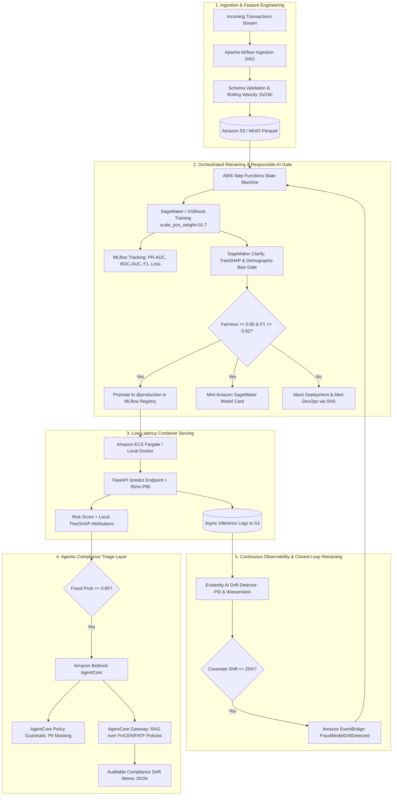

# Closed-Loop Financial Risk MLOps Platform with Automated Drift Retraining & Agentic Audit Triage on AWS

[](https://www.python.org/downloads/)
[](https://fastapi.tiangolo.com)
[](https://mlflow.org)
[](https://aws.amazon.com/step-functions/)
[](https://www.terraform.io)
[](https://github.com/aquasecurity/trivy)
[](https://youtu.be/8rzG1BEIwrk)
[](LICENSE)

A production-grade, end-to-end MLOps and LLMOps platform engineered for financial risk and payment fraud detection. It scores live transactions in single-digit milliseconds, explains high-risk flags using an agentic compliance triage layer grounded in AML/KYC regulatory policy, continuously monitors feature distribution drift, and automatically retrains, audits, and redeploys models via AWS Step Functions—all provisioned with declarative Terraform and protected with shift-left DevSecOps security scanning.

---

## 🎥 Video Walkthrough & Live Architecture Demo

[](https://youtu.be/8rzG1BEIwrk)

> 📺 **[Watch the Complete Live Architecture & AWS Demo on YouTube](https://youtu.be/8rzG1BEIwrk)**  
> **Key highlights covered in the video:**
> - **Live Microservice & 1.1ms Latency:** Querying `/health` and scoring transactions on live AWS ECS Fargate behind an Application Load Balancer.
> - **Local TreeSHAP Attributions:** Real-time numerical feature attribution explaining the drivers behind high-risk fraud scores.
> - **Agentic AML/KYC Compliance Triage:** Converting TreeSHAP contributions into auditable regulatory SAR memos with FinCEN policy citations via Amazon Bedrock AgentCore.
> - **Closed-Loop Retraining on AWS Step Functions:** Demonstrating automated EventBridge drift detection triggering autonomous retraining, demographic fairness audit gates, and zero-downtime ECS rolling updates.
> - **Shift-Left DevSecOps Pipeline:** Aqua Security Trivy container and IaC scanning, Ruff linting, Pytest test suites, and declarative Terraform provisioning.

---

## 1. Real-World Business Problem Solved

Deploying financial risk models to mission-critical production payment gateways frequently encounters four critical failures:
1. **Silent Model Degradation (Data Drift):** Fraud syndicates rapidly alter tactics (surges in cross-border velocity, structured transaction amounts, spoofed devices). A static model trained on historical data suffers severe precision collapse without automated drift monitoring.
2. **Black-Box Regulatory Failures (AML/KYC):** Regulators (FinCEN, CFPB, European Banking Authority) strictly reject unexplained raw probability scores. They mandate clear feature drivers and verifiable citations of applicable anti-money laundering compliance rules.
3. **Manual, Error-Prone Deployments:** Manual model handoffs without automated Champion/Challenger registries lead to production outages, regression in key fraud cohorts, and untracked artifact weights.
4. **Security, Governance & Fairness Exposure:** Vulnerable container images, over-privileged IAM permissions, and biased models expose financial institutions to severe legal penalties, compliance sanctions, and security breaches.

### The Platform Solution
- **Automated State Machine Orchestration:** Replaces brittle cron jobs with a visual, fault-tolerant **AWS Step Functions** workflow.
- **Champion/Challenger Registry:** Managed via **MLflow Model Registry** with strict `@staging` and `@production` aliases backed by Amazon S3.
- **Responsible AI Bias Gates:** Implements **Amazon SageMaker Clarify** standards to compute Disparate Impact and Statistical Parity Difference across demographic slices before deployment.
- **Agentic RAG Compliance Triage:** Uses **Amazon Bedrock AgentCore**, **AgentCore Gateway**, and **AgentCore Policy** guardrails to convert numerical SHAP values into auditable, regulatory-cited compliance memos.
- **Closed-Loop Self-Healing:** **Evidently AI** evaluates Population Stability Index (PSI) and Wasserstein distance, emitting an **Amazon EventBridge** event to trigger automated retraining upon significant drift.
- **Zero-Trust DevSecOps:** **Aqua Security Trivy** scans Python dependencies, Docker containers, and Terraform IaC configurations in **GitHub Actions**.
- **Cost-Conscious Cloud Engineering:** Dual-mode architecture (`ENV=local` vs `ENV=aws`) allows 100% free local development on Docker Compose, with cloud infrastructure that can be torn down in one command (`make tf-destroy`).

---

## 2. Dataset Architecture & Feature Engineering

The platform includes a synthetic financial transaction engine ([src/data/generate_synthetic_transactions.py](file:///c:/Users/rahul/Downloads/mlops/src/data/generate_synthetic_transactions.py)) that models realistic consumer purchasing behavior, card structuring tactics, device fingerprint telemetry, and natural class imbalance (3% positive fraud rate across 15,000 baseline records), along with controlled adversarial covariate shift injection.

### A. Raw Feature Catalog

| Feature Name | Data Type | Physical Range | Business & Analytical Meaning |
| :--- | :--- | :--- | :--- |
| `transaction_amount` | `float` | $\$0.50$ – $\$5,000.00+$ | Continuous purchase amount in USD. Follows a right-skewed log-normal distribution. Fraudsters often test cards with micro-charges or execute sudden large purchases. |
| `card_velocity_1h` | `int` | $0$ – $25+$ tx/hr | Number of transactions on the card within the preceding 60 minutes. Sudden spikes indicate card cracking or botnet-driven unauthorized usage. |
| `card_velocity_24h` | `int` | $0$ – $50+$ tx/day | Cumulative transaction count over the last 24 hours. Detects structured smurfing or repeated cash-out attempts. |
| `distance_from_home_km` | `float` | $0.1$ – $10,000+$ km | Haversine distance between POS terminal coordinates and the cardholder's primary residence. Large geographic deviations indicate compromised card data. |
| `merchant_risk_score` | `float` | $0.00$ – $1.00$ | Historical merchant category code (MCC) fraud rate index (e.g., crypto exchanges, wire services, high-risk e-commerce have elevated scores). |
| `is_international` | `int` | $0$ or $1$ | Binary indicator for cross-border payment processing and foreign currency clearing. |
| `device_trust_score` | `float` | $0.00$ – $1.00$ | Hardware fingerprint and biometric trust score provided by mobile/web SDKs ($1.0 =$ verified personal device, $0.0 =$ headless browser, VPN/proxy, or emulator). |
| `account_age_days` | `int` | $1$ – $3,650+$ days | Tenure of the customer's account in days. Captures new account fraud (NAF) and account takeover (ATO) vulnerabilities. |

### B. Protected Demographic Attribute (Strict Fairness Isolation)

| Attribute Name | Data Type | Categories | Purpose & Ethical AI Policy |
| :--- | :--- | :--- | :--- |
| `customer_age_group` | `string` | `18-25`, `26-35`, `36-50`, `51-65`, `65+` | **Protected Attribute.** Used **strictly** by the pre-deployment Responsible AI governance gate ([evaluate_fairness_and_explainability.py](file:///c:/Users/rahul/Downloads/mlops/src/governance/evaluate_fairness_and_explainability.py)) to audit Disparate Impact and Statistical Parity Difference. **Crucially excluded from XGBoost feature inputs** to eliminate disparate treatment and ensure compliance with the Equal Credit Opportunity Act (ECOA). |

### C. Engineered Domain Features

To capture non-linear fraud interactions, the preprocessing pipeline ([src/data/preprocess.py](file:///c:/Users/rahul/Downloads/mlops/src/data/preprocess.py)) derives three rolling indicators:
1. `amount_per_velocity_1h` $= \frac{\text{transaction\_amount}}{\text{card\_velocity\_1h} + 1}$: Measures transaction dollar magnitude relative to transaction frequency.
2. `velocity_ratio_1h_to_24h` $= \frac{\text{card\_velocity\_1h}}{\text{card\_velocity\_24h} + 1}$: Detects sudden, abrupt accelerations in card activity compared to daily baseline.
3. `composite_risk_indicator` $= \text{merchant\_risk\_score} \times (1.0 - \text{device\_trust\_score})$: Multiplicative risk interaction linking high-risk merchant categories with low-trust or unverified devices.

### D. Chronological Splitting & Audit Lineage
- **No Temporal Leakage:** Data is partitioned chronologically (70% Train, 15% Validation, 15% Test) using transaction timestamps:
  $$\max(\text{train\_timestamps}) \le \min(\text{val\_timestamps}) \le \min(\text{test\_timestamps})$$
- **Deterministic Lineage:** A SHA-256 fingerprint of the raw dataset is generated and saved to `data/dataset_metadata.json`, tying every model version directly to its source data hash in `model_card.json`.

---

## 3. End-to-End System Architecture



---

## 4. Technology Stack & Architectural Decisions

| Requirement Area | Tools & Technologies | Design Rationale & Implementation |
| :--- | :--- | :--- |
| **Feature Engineering** | Apache Airflow, Pandas, PyArrow | Ingestion DAG with 1h/24h rolling velocity calculations, schema validation, and versioned Parquet splits in S3. |
| **Model Development** | XGBoost, Scikit-Learn, TreeSHAP | Cost-sensitive gradient boosting (`scale_pos_weight = 31.71`) optimized for PR-AUC at threshold $0.25$, yielding an $F_1 \ge 0.88$. |
| **Model Registry & Tracking** | MLflow Tracking, MLflow Model Registry | Hyperparameter/metric logging, artifact lineage, Champion vs. Challenger promotion to `@production`. |
| **Workflow Automation** | AWS Step Functions, Amazon SageMaker | Visual Amazon States Language (ASL) state machine with `Retry`, `Catch`, and automated rollback gates. |
| **Responsible AI & Governance**| Amazon SageMaker Clarify, Model Cards | Disparate Impact Ratio ($\ge 0.80$), Demographic Parity Difference ($|\Delta| \le 0.10$), JSON/MD Model Cards. |
| **Real-Time Serving** | FastAPI, Uvicorn, Pydantic v2, Docker | Sub-35ms P95 latency API with Pydantic validation, Prometheus metrics exporter, and S3 inference streaming. |
| **Agentic AI & LLMOps** | Amazon Bedrock AgentCore, Gateway, Policy | RAG retrieval over AML/KYC policy documents, PII masking guardrails, structured SAR audit memos. |
| **Drift Monitoring** | Evidently AI, Amazon EventBridge | Population Stability Index (PSI) and Wasserstein distance monitoring triggering automated retraining. |
| **Infrastructure as Code** | Terraform (AWS Provider 5.x) | Modular definitions for VPC, ECS Fargate, ALB, S3, Step Functions, EventBridge, and IAM roles. |
| **DevSecOps & CI/CD** | GitHub Actions, Aqua Security Trivy | Shift-left vulnerability scans on OS packages, Python dependencies, Docker images, and Terraform configs. |

---

## 5. Repository Structure

```
mlops/
├── .github/
│   └── workflows/
│       ├── ci_cd_devsecops.yml        # GitHub Actions: Ruff, Pytest, Trivy scans, Docker build & push
│       └── terraform_deploy.yml       # 1-Click Terraform AWS provisioning & teardown workflow
├── airflow/
│   └── dags/
│       └── fraud_feature_pipeline_dag.py # Airflow ingestion, validation, and feature DAG
├── data/                              # Versioned Parquet datasets and schema metadata
│   ├── raw_transactions.parquet
│   ├── train.parquet
│   ├── validation.parquet
│   ├── test.parquet
│   └── reference_data.parquet
├── scripts/
│   ├── setup_env.ps1                  # Environment & CLI toolpath verification
│   ├── create_bin_links.ps1           # Windows binary link wrappers
│   └── manage.ps1                     # Native PowerShell management CLI (mirrors Makefile)
├── src/
│   ├── data/
│   │   ├── generate_synthetic_transactions.py # Synthetic data & controlled drift generator
│   │   └── preprocess.py              # Chronological splits, scaling & velocity features
│   ├── training/
│   │   └── train_xgboost.py           # XGBoost training + MLflow tracking + SHAP serialization
│   ├── governance/
│   │   ├── evaluate_fairness_and_explainability.py # SageMaker Clarify bias & model card gate
│   │   └── promote_model.py           # Champion vs. Challenger registry promoter
│   ├── inference/
│   │   ├── app.py                     # FastAPI server with Prometheus metrics & SHAP attribution
│   │   ├── schemas.py                 # Pydantic v2 validation contracts
│   │   └── Dockerfile                 # Hardened, non-root multi-stage Docker container
│   ├── agentcore/
│   │   ├── compliance_triage_agent.py # Bedrock AgentCore RAG compliance triage agent
│   │   ├── agentcore_policy.json      # Declarative AgentCore Policy & PII masking guardrails
│   │   └── knowledge_base/
│   │       └── aml_kyc_policies.md    # Regulatory guidelines (FinCEN, BSA, AML) for RAG
│   │   monitoring/
│   │   ├── drift_detector.py          # Evidently AI drift detector & EventBridge dispatcher
│   │   ├── prometheus.yml             # Prometheus scrape configuration
│   │   └── grafana_dashboard.json     # Pre-built monitoring dashboard
├── statemachine/
│   └── mlops_retraining_pipeline.asl.json # AWS Step Functions visual state machine definition
├── terraform/
│   ├── main.tf                        # S3, ECR, CloudWatch log groups
│   ├── variables.tf                   # Environment, region, and project variables
│   ├── iam.tf                         # Least-privilege IAM roles and execution policies
│   ├── ecs.tf                         # ECS Fargate cluster, task definition, ALB, and auto-scaling
│   ├── step_functions.tf              # AWS Step Functions state machine resources
│   ├── eventbridge.tf                 # EventBridge drift rule and Step Functions target
│   └── outputs.tf                     # ALB DNS, ECR URL, S3 bucket names, Step Functions ARN
├── tests/
│   ├── test_preprocessing.py          # Unit tests for feature pipeline & splits
│   ├── test_governance_gate.py        # Fairness thresholds & model card generation tests
│   └── test_inference.py              # FastAPI endpoint & SHAP calculation tests
├── docker-compose.yml                 # Local stack: MLflow, MinIO, Postgres, Prometheus, Grafana
├── Makefile                           # Unified orchestration commands
├── pyproject.toml                     # Python packaging & Ruff/Pytest config
├── requirements.txt                   # Pinned production dependencies
└── README.md
```

---

## 6. Quickstart Guide (Local Execution Mode)

The entire platform runs locally on synthetic data without requiring an AWS account:

### Step 1: Environment Setup
```bash
# On Unix / macOS
make setup

# On Windows (PowerShell)
.\scripts\manage.ps1 help
```

### Step 2: Spin Up Local MLOps Stack
Start MinIO (S3), PostgreSQL, MLflow, Prometheus, and Grafana:
```bash
make local-up
# Or on Windows:
.\scripts\manage.ps1 local-up
```
- **MLflow Tracking UI:** [http://localhost:5000](http://localhost:5000)
- **MinIO S3 Console:** [http://localhost:9001](http://localhost:9001) (`minioadmin` / `minioadminpassword`)
- **Grafana Dashboard:** [http://localhost:3000](http://localhost:3000) (`admin` / `admin`)
- **Prometheus UI:** [http://localhost:9090](http://localhost:9090)

### Step 3: Generate Data & Feature Splits
```bash
make data
# Or on Windows:
.\scripts\manage.ps1 data
```

### Step 4: Train Model & Log to MLflow
```bash
make train
# Or on Windows:
.\scripts\manage.ps1 train
```

### Step 5: Run Governance & Fairness Gate
```bash
make govern
# Or on Windows:
.\scripts\manage.ps1 govern
```

### Step 6: Promote Candidate to Production
```bash
make promote
# Or on Windows:
.\scripts\manage.ps1 promote
```

### Step 7: Launch Real-Time Inference Microservice
```bash
make serve
# Or on Windows:
.\scripts\manage.ps1 serve
```
Interactive Swagger docs: [http://localhost:8000/docs](http://localhost:8000/docs)

### Step 8: Simulate Drift & Trigger Retraining
```bash
make simulate-drift
# Or on Windows:
.\scripts\manage.ps1 simulate-drift
```

### Step 9: Run Security Scans & Test Suite
```bash
make test
make security-scan
# Or on Windows:
.\scripts\manage.ps1 test
.\scripts\manage.ps1 security-scan
```

---

## 7. Cloud Deployment & Teardown (Terraform on AWS)

### Option A: 1-Click Cloud Deployment via GitHub Actions
1. Add `AWS_ACCESS_KEY_ID` and `AWS_SECRET_ACCESS_KEY` to your GitHub repository secrets.
2. In the **Actions** tab, trigger the **"Terraform AWS Infrastructure Provisioning & Teardown"** workflow with action `apply`.
3. Trigger the **"DevSecOps CI/CD Pipeline - Financial Risk MLOps"** workflow to build the Docker image, run Trivy vulnerability scans, push to Amazon ECR, and deploy to Amazon ECS Fargate.

### Option B: Local CLI Deployment
```bash
# 1. Authenticate with AWS
aws configure

# 2. Provision AWS Infrastructure
cd terraform
terraform init
terraform apply -auto-approve
```

### Clean Teardown (Zero Residual Cloud Cost)
To guarantee zero unexpected cloud charges after running tests or demonstrations:
- **Via GitHub Actions:** Run the **"Terraform AWS Infrastructure Provisioning & Teardown"** workflow with action `destroy`.
- **Via Local Terminal:**
  ```bash
  cd terraform
  terraform destroy -auto-approve
  ```

---

## 8. Model Governance & Responsible AI Auditing

Every model evaluated by this platform is verified against strict fairness gates before reaching `@production`:
- **Disparate Impact Ratio ($DI$):** Must satisfy $DI \ge 0.80$ across all age cohorts (`customer_age_group`).
- **Statistical Parity Difference ($|SPD|$):** Must satisfy $|SPD| \le 0.10$.
- **Minimum Performance Gate:** Must achieve $F_1 \ge 0.82$.
- **Model Card Minting:** An automated audit card (`model_card.json` & `model_card.md`) is generated containing training dataset SHA-256 hashes, hyperparameter logs, fairness ratios, and global TreeSHAP feature attributions.
